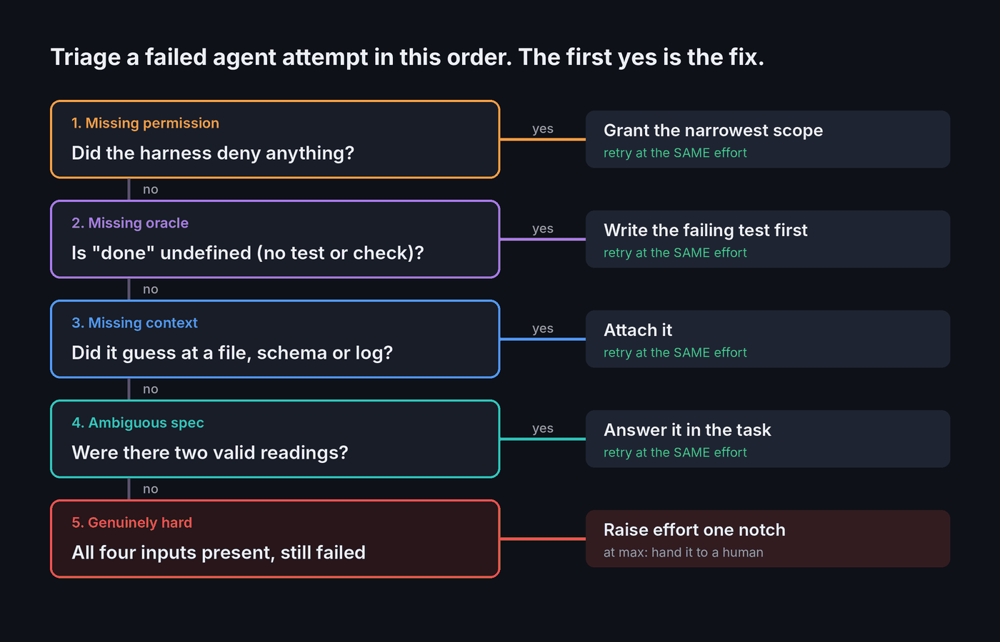
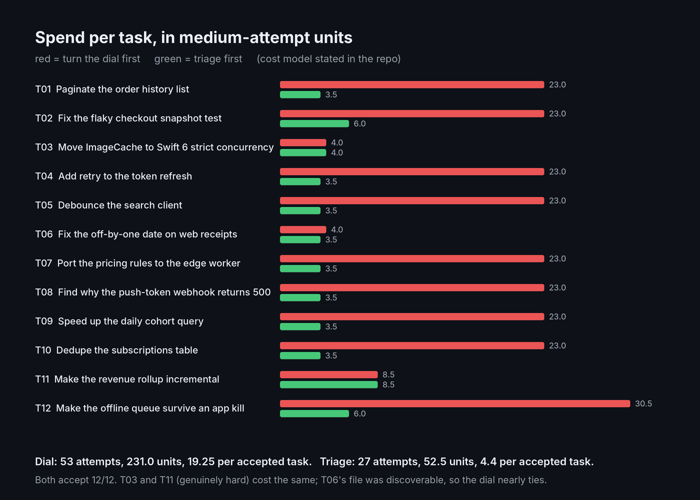

# FailureTriage

**When a coding agent gets it wrong, don't turn up the effort dial. Find the missing input first.**

A small Swift library that sorts a failed agent attempt into one of five buckets, in a fixed order, and returns the fix. Only the last bucket ever escalates effort.

| # | Bucket | Evidence | Remedy (retry at the same effort) |
|---|--------|----------|------------------------------------|
| 1 | Missing permission | the harness denied a tool call | grant the narrowest scope |
| 2 | Missing oracle | no test or check defines "done" | write the failing test first |
| 3 | Missing context | it guessed at a file, schema or log | attach it |
| 4 | Ambiguous spec | two valid readings | answer it in the task |
| 5 | Genuinely hard | all four inputs present | raise effort one notch; at `max`, hand to a human |

Article: (added after publish)



## The core

```swift
let evidence = AttemptEvidence(
    permissionDenials: ["Read(Tests/__Snapshots__/**)"],
    missingReferences: [MissingReference("SnapshotConfig.swift", discoverable: true)]
)
let result = Triage.classify(evidence, at: .medium)
result.primary      // .missingPermission — a denied read hides the file the agent could have found
result.remedy       // .grant(["Read(Tests/__Snapshots__/**)"])
result.mayEscalate  // false
```

## The simulation

`SampleScenario` is 12 **constructed** tasks across Swift, TypeScript and SQL: ten built with a missing input, two genuinely hard (`hardFloor` of `.high` and `.xhigh`). `Simulator` runs two policies over them:

- **Turn the dial** — on failure, go up one effort level; only after `max` fails does anyone triage, and the dial is never turned back down.
- **Triage first** — classify, fix the first bucket, retry at the same effort.

| Policy | Accepted | Attempts | Spend | Per accepted task |
|--------|----------|----------|-------|-------------------|
| Turn the dial | 12/12 | 53 | 231.0 | 19.25 |
| Triage first | 12/12 | 27 | 52.5 | 4.375 |



**The cost model is an assumption, stated in code (`Effort.relativeCost`, `CostModel`):** one attempt at `low`/`medium`/`high`/`xhigh`/`max` costs 0.5/1/2/3.5/6 units; each rejected attempt costs 1 unit of review; each input fix costs 0.5 units of lead time. More effort recovers a missing reference only if it is `discoverable` (in the workspace and readable) and no permission is denied. A real agent at high effort will sometimes write its own test or pick the right reading of a spec, so this model flatters triage on those buckets. Every number above is asserted in `Tests/`.

## Demo app

Three tabs: **Triage** (each task's bucket, remedy and attempt trail), **Dial vs triage** (totals and per-task spend), **Checklist** (the five questions in order).

Screenshots from CI's Simulator run land in `Demo/Screenshots/`.

## How to run it

```bash
git clone https://github.com/rajatslakhina/failure-triage-article-demo.git
cd failure-triage-article-demo
swift test                 # 15 tests
open Demo.xcodeproj        # pick an iPhone Simulator, press Run
```

No other setup: `Demo.xcodeproj` consumes the library through a local package reference to this same repo.

## Verification status

- `swift build -Xswiftc -warnings-as-errors` and `swift test` (15 tests): pass on Swift 6.1.2, Linux.
- macOS build, `Demo.xcodeproj` build and Simulator launch: run by `.github/workflows/ci.yml` on `macos-15`, which commits real screenshots back to `Demo/Screenshots/`. See the Actions tab for the latest result.

## Sources

- [Claude Code changelog 2.1.292](https://code.claude.com/docs/en/changelog) — `effort` parameter on the Agent tool.
- Kevin Riedl, [Claude Opus 5.5: Best Uses, Prompts and Effort Settings](https://wavect.io/blog/claude-opus-5-5-best-use-cases-workflows/) (Wavect, 24 Sep 2026) — start at medium; check for the missing ingredient; cost per accepted task.

MIT licensed.
